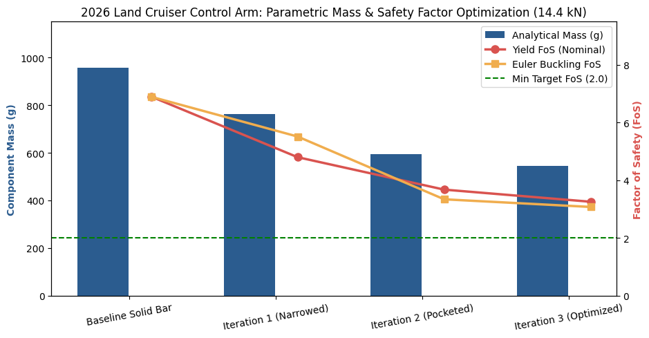

# Front Suspension Control Arm: Parametric Design Optimization & Analytical Stress Analysis
**Vehicle Reference:** 2026 Toyota Land Cruiser EXR (GVW: 3,120 kg | Front Axle Share: 52.2% — *Source: Toyota UAE Technical Specifications*)

## Engineering Objective
Perform a parametric design optimization of an Aluminum 6061-T6 front lower control arm (`340 mm` pin-to-pin span) to minimize unsprung mass while maintaining a minimum **Factor of Safety ≥ 2.0** against both material yield and Euler column buckling.

## Load Derivation & Modeling Assumptions
- **Static Front Axle Load:** $3,120\text{ kg} \times 0.522 \times 9.81\text{ m/s}^2 = 15,990.3\text{ N}$
- **Outer Wheel Dynamic Transfer ($75\%$):** $11,992.7\text{ N}$
- **Peak Lateral Design Load ($\mu = 1.2g$):** **$14,391.3\text{ N}$ ($\approx 14.4\text{ kN}$)**
- **Key Simplifications & Limitations:**
  1. *Load-Path Assumption:* Simplified by applying the tire lateral force directly along the control arm axis rather than resolving suspension linkage leverage ratios.
  2. *Conservative Envelope:* Stacking full GVW, 75% lateral load transfer, and $1.2g$ lateral grip represents an extreme upper-bound load case (a full-size SUV would reach its rollover threshold before $1.2g$ on standard tires).
  3. *Stress Concentration:* Calculated nominal combined axial + eccentric bending stresses (`15 mm` offset) without geometric stress concentration factors ($K_t$) at the bolt holes or pocket corners; `5 mm` pocket floor fillets were added in CAD to mitigate local stress risers.

## Parametric Optimization Results
| Design Iteration | Geometry | Analytical Mass | CAD Mass (Fusion 360) | Nominal Stress | Yield FoS | Euler Buckling FoS ($K=1.0$) |
| :--- | :--- | :---: | :---: | :---: | :---: | :---: |
| **Baseline Solid Bar** | $60 \times 15\text{ mm}$ | 955.7 g | 955.7 g | 36.7 MPa | 7.52 | 7.98 |
| **Iteration 1 (Narrowed)** | $48 \times 15\text{ mm}$ | 761.3 g | — | 57.3 MPa | 4.82 | 6.38 |
| **Iteration 2 (Pocketed)** | $46 \times 15\text{ mm}$ ($26 \times 8\text{ mm}$ pocket) | 594.3 g | — | 74.5 MPa | 3.70 | 3.45 |
| **Iteration 3 (Optimized)** | $44 \times 15\text{ mm}$ ($26 \times 9\text{ mm}$ pocket + $5\text{ mm}$ fillets) | 546.5 g | **525.9 g** | **84.6 MPa** | **3.26** | **3.01** |

**Outcome:** Reduced CAD component mass by **45.0%** (`955.7 g` $\rightarrow$ `525.9 g`, saving `429.8 g` per arm) while maintaining nominal yield (`3.26`) and weak-axis Euler buckling (`3.01`) safety factors above the `2.0` target.

## Visualizations & CAD Models

| Baseline Model (`955.7 g`) | Optimized Model (`525.9 g`) |
| :---: | :---: |
|  |  |